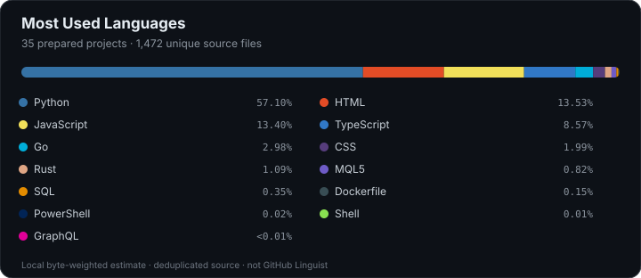

# Douglas Silva

### Full Stack Developer · Backend Engineering · Applied AI

I build full stack applications, data systems, and automation tools, with a focus on backend engineering and applied AI. Developing independent software projects since 2019, across APIs, databases, asynchronous processing, user interfaces, and developer tooling.

**Open to backend and full stack roles** involving applied AI, automation, developer tools, or data-intensive products.

## Language mix

## Technical focus

| Backend and data | Frontend and visualization |
| --- | --- |
| Python · FastAPI · Go · Rust · Node.js | TypeScript · JavaScript · React |
| PostgreSQL · SQLite · Redis · NATS JetStream · Docker | Three.js · HTML · CSS |

| Applied AI and developer tools | Automation and blockchain |
| --- | --- |
| Model Context Protocol (MCP) · LLM integrations · local inference | Blockchain data systems · RPC monitoring |
| Typed output validation · versioned policies · decision records | Electron · browser automation · MQL5 |

## Selected projects

- [Market Data Platform](https://github.com/qquante/market-data-platform) — Python/FastAPI ingestion with PostgreSQL, Redis, a transactional outbox, and recoverable event delivery.
- [Agent Workspace Manager](https://github.com/qquante/agent-workspace-manager) — Go and Docker workspaces with provider access controls, usage records, and MCP policies.
- [Content Intelligence Engine](https://github.com/qquante/content-intelligence-engine) — Applied AI integrations with typed outputs, evidence-linked assessments, and a persistent decision ledger.
- [Contract Analysis Runtime](https://github.com/qquante/contract-analysis-runtime) — Resumable security-analysis workflows with explicit evidence states and an MCP interface.
- [Interactive Retail Storefront](https://github.com/qquante/interactive-retail-storefront) — A React/TypeScript retail prototype with catalogue navigation, a local bag, and Three.js visuals.
- [Persistent Web Workspaces](https://github.com/qquante/persistent-web-workspaces) — An Electron desktop application for organizing persistent browser profiles and isolated sessions.

I work end to end: clarify the problem, define data and API contracts, build the backend and interface, and validate behavior with automated checks. I pay close attention to persistent state, failure handling, and traceability so workflows can be inspected and resumed.

